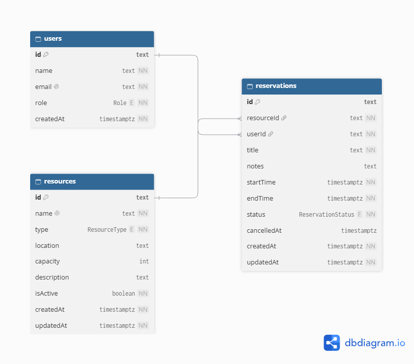
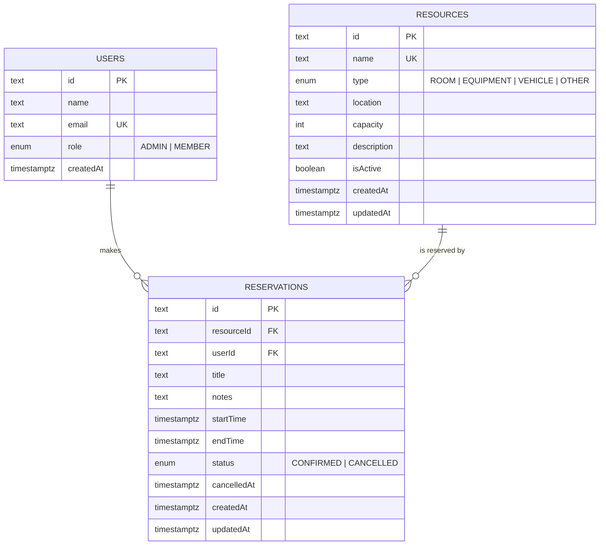

# Entity Relationship diagram

**Shareable diagram:** https://dbdiagram.io/d/Reserve-Hub-ER-Diagram-6acf4378064322c8694755c6
The diagram below is also drawn directly by GitHub, so it stays visible even without the link.

## Integrity rules enforced by the database

| Rule | Mechanism |
| --- | --- |
| End time is after start time | `CHECK ("endTime" > "startTime")` |
| No two confirmed reservations overlap on the same resource | `EXCLUDE USING gist ("resourceId" WITH =, tstzrange("startTime","endTime",'[)') WITH &&) WHERE ("status" = 'CONFIRMED')` |
| A resource or user with history cannot be deleted | `ON DELETE RESTRICT` on both foreign keys |
| Unique emails and resource names | unique indexes |
